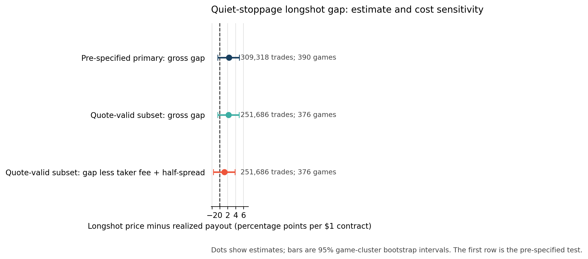
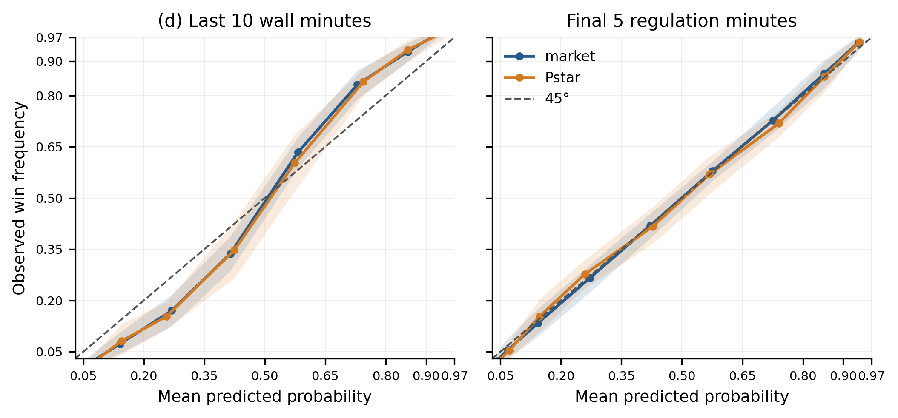
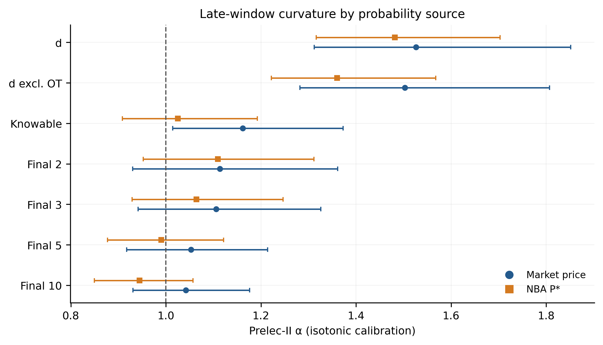
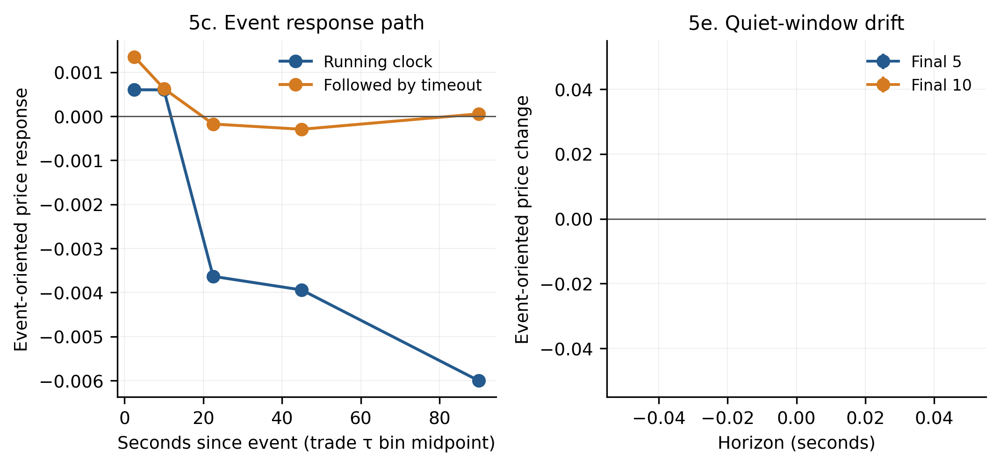

# Late-game NBA prediction markets

Working thesis on late-game NBA prediction-market pricing. [Read the current draft](Current_Thesis_Draft.md) · [Word version](Current_Thesis_Draft.docx) · [PDF version](Current_Thesis_Draft.pdf)

## Main finding

| Sample and estimator | Price − payoff (pp; 95% CI) | Trades · games |
|---|---:|---:|
| Final five, equal-game | **+3.44** (+1.76 to +5.01) | 1,681,533 · 684 |
| Final five, pooled trade | +1.28 (−2.39 to +4.41) | 1,681,533 · 684 |
| Final five, first entry per game | −0.60 (−3.26 to +1.89) | 684 · 684 |
| Final five quiet stoppages, equal-game | +2.33 (−0.53 to +4.94) | 309,318 · 390 |

Equal-game and pooled-trade estimates use the full final-five 5–20¢ longshot sample but weight it differently; first-entry uses one trade per game. The game-weighted point estimate remains between +3.41 and +3.57 when any one game is omitted. Intervals are nominal and unadjusted across estimands. The quiet-stoppage interval includes zero, and timeout/restart filtering uses some later play-by-play information; its contrast with the full final-five estimate is descriptive, not causal.

### Retrospective-window selection check

| Venue, final 10 minutes before last play | Observed win rate − price | Selection-model prediction | Remainder | Sample |
|---|---:|---:|---:|---:|
| Kalshi | −6.24 | −6.24 | 0.00 | 532,303 trades · 561 games |
| Polymarket | −6.41 | −6.39 | −0.02 | 49,659 fills · 265 games |

These pooled results are sensitive to weighting and chronology. The equal-game remainder is −0.98 points for Kalshi (95% CI −2.17 to +0.35) and +2.89 for Polymarket (−0.13 to +6.19). A later-game Kalshi holdout gives +1.89 (−3.68 to +9.41). This is predictive accounting, not causal evidence.

### Calibration comparison

| Sample | Prelec curvature α (95% CI) | Trades · games |
|---|---:|---:|
| Moshrefi near-expiry reference | 1.516 | 327,473 |
| Thesis, March 1–May 15 | 1.674 (1.125 to 2.499) | 659,214 · 334 |
| Thesis, full regular season | 1.526 (1.311 to 1.856) | 2,524,781 · 1,202 |

The observation-count convention is unresolved, so this is a qualified comparison, not an exact replication.

## Figures

### Primary estimate and cost sensitivity

### Retrospective-window selection validation

### Market calibration versus game-state benchmark

### Curvature by window

### Event response and price drift

## Tables and analysis files

- [Matched-band final-five estimates](data/interim/phase5/phase5_final5_longshot_weighting.csv) · [recompute script](src/phase5_final5_longshot_weighting.py)
- LaTeX tables: [primary and cost checks](tables/phase5/primary_estimand_band_tests.tex) · [paired residuals](tables/phase5/paired_residuals.tex) · [weighting sensitivity](tables/phase5/weighting_sensitivity.tex) · [calibration comparison](tables/phase5/replication_5a_d.tex)
- [Analysis guide and reproduction limits](ANALYSIS_README.md) · [detailed results](RESULTS.md) · [Polymarket results](RESULTS_POLYMARKET.md) · [corrections and deviations](DEVIATIONS.md)

The repository includes code and compact result summaries. The approximately 38 GB raw and intermediate data cache is not included, so full reproduction requires those local inputs. The repository is private and has no license selected.
