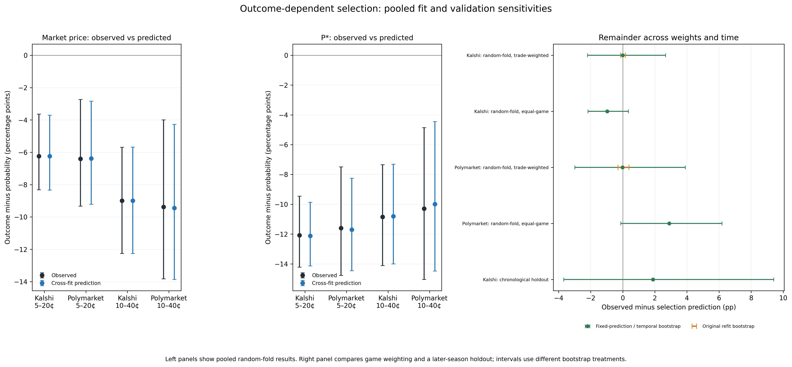
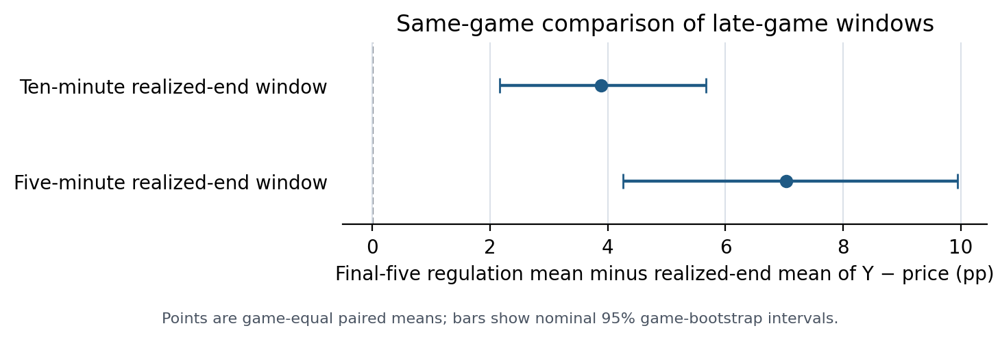
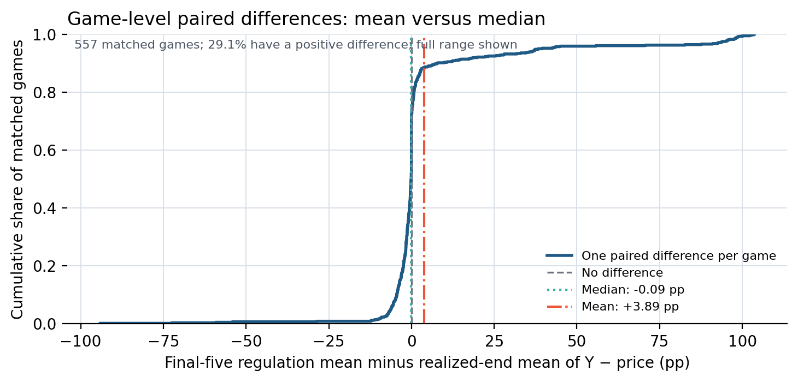
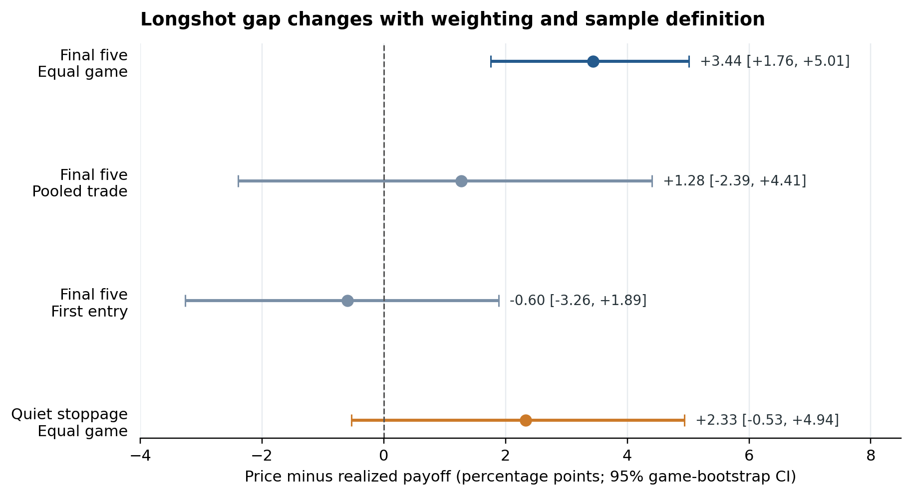
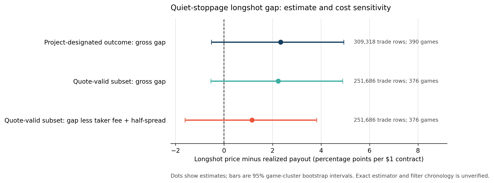

# Late-game NBA prediction markets

Working thesis and analysis package: [PDF](Current_Thesis_Draft.pdf) · [Word](Current_Thesis_Draft.docx) · [Markdown](Current_Thesis_Draft.md)

## Main results

| Analysis | Estimate (percentage points; nominal 95% CI) | Sample |
|---|---:|---:|
| Retrospective 10-minute window: observed `Y − price` | −6.24 (−8.32 to −3.64) | 532,303 rows · 561 games |
| Cross-fitted prediction of that pooled gap | −6.24 (−8.33 to −3.71) | Same held-out target trades |
| Remainder, predictions held fixed | −0.003 (−2.20 to +2.67) | Same 561 games |
| Equal-game remainder | −0.98 (−2.17 to +0.35) | Same 561 games |
| Chronological holdout remainder | +1.89 (−3.68 to +9.41) | 161,087 rows · 137 games |
| Paired clock-window minus realized-end mean | +3.89 (+2.16 to +5.67) | 557 matched games |
| Project-designated quiet-stoppage `price − payoff` | +2.33 (−0.53 to +4.94) | 309,318 rows · 390 games |
| Quiet estimate after estimated taker fees and half-spread | +1.15 (−1.62 to +3.82) | 251,686 quote-valid rows · 376 games |

The matched-window contrast holds the games, price band, and benchmark support constant, but uses different trade rows and game states. Its median game-level difference is −0.09 points; an overtime-excluded diagnostic is near zero, but excluding overtime is outcome-dependent. The contrast is descriptive and does not identify a causal effect of window definition.

The cross-fitted model reproduces the pooled retrospective gap, but equal-game aggregation and chronological validation do not establish a stable prediction. The quiet-stoppage result is imprecise, its filters are not verified against a dated protocol, and the cost-adjusted interval includes zero. These results do not establish an exploitable strategy.

## Analysis materials

- [Analysis and reproduction guide](ANALYSIS_README.md) · [Detailed results](RESULTS.md) · [Polymarket results](RESULTS_POLYMARKET.md)
- [Cross-fit diagnostic](data/interim/phase5/phase5_crossfit_selection_diagnostic.json) · [Inference audit](data/interim/phase5/phase5_selection_inference_audit.json) · [Chronological validation](data/interim/phase5/phase5_temporal_selection_validation.json)
- [Paired window comparison](data/interim/phase5/phase5_paired_window_contrast.json) · [Per-game paired differences](data/interim/phase5/phase5_paired_window_game_differences.csv) · [Project-designated quiet-stoppage cost results](data/interim/phase5/phase5_primary_costs.json) · [Weighting contrasts](data/interim/phase5/phase5_final5_estimand_contrasts.csv)
- [Paired comparison code](src/phase5_paired_window_contrast.py) · [Cross-fit code](src/phase5_crossfit_selection_diagnostic.py) · [Weighting-audit code](src/phase5_weighting_audit.py) · [Specification status](SPECIFICATION_STATUS.md) · [Corrections and deviations](DEVIATIONS.md)
- [Earlier draft v1](archive/v1_2026-11-03/Current_Thesis_Draft_v1.md) · [Draft v2](archive/v2_2026-11-03/Current_Thesis_Draft_v2.md) · [Draft v3](archive/v3_2026-11-03/Current_Thesis_Draft_v3.md) · [Draft v4](archive/v4_2026-11-03/Current_Thesis_Draft_v4.md)

The repository contains code and selected summaries but omits approximately 38 GB of raw and intermediate caches. Full reproduction requires the original project workspace. The paired comparison can be rerun there with `python github_release/src/phase5_paired_window_contrast.py --project-root . --output-dir github_release/data/interim/phase5`.
